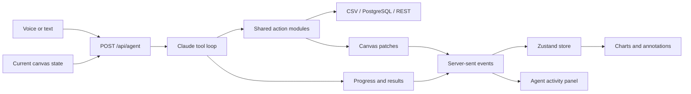

<p align="center">
  
</p>

# Vox

**Talk to your data. Watch the answer take shape.**

Vox is a voice-first analytics canvas that connects natural-language questions to data queries and charts. An AI agent works alongside the canvas, showing its actions as it explores your data.

Built for the **Builder.io Agent-Native Hackathon**.

[Live demo](https://vox-blue.vercel.app) · [Open canvas](https://vox-blue.vercel.app/canvas) · [Source](https://github.com/sammy-XXIV/vox)

Vox is a hackathon prototype. The landing page includes an illustrative demo with example data; the interactive workspace lives at `/canvas`. See [current limitations](#current-limitations) for integration gaps.

## Features

- **Voice input** through the browser’s Web Speech API, with a text fallback when speech recognition is unavailable.
- **An action-based AI agent** powered by Claude, with progress, tool calls, results, and errors streamed to the activity panel.
- **Five chart renderers:** bar, line, scatter, pie, and country choropleth maps.
- **A zoomable canvas** with range brushes on bar and line charts containing more than ten rows.
- **Chart annotations and removal** through UI controls and shared action modules.
- **Data adapters** for CSV files, PostgreSQL, and REST APIs returning JSON rows.
- **A responsive landing page** with a one-time workflow demo and support for reduced-motion preferences.

## Run locally

### Requirements

- Node.js **24.15+ on the 24.x line**, recommended for the installed development and test tools. Node.js 22.22.2+ on the 22.x line is also supported by those tools.
- npm.
- An Anthropic API key with access to `claude-sonnet-4-6`, the model configured in [`lib/agent.ts`](lib/agent.ts).

### Setup

```bash
git clone https://github.com/sammy-XXIV/vox.git
cd vox
npm ci
```

Copy `.env.example` to `.env.local` and set your key:

```dotenv
ANTHROPIC_API_KEY=your_api_key
```

`ANTHROPIC_BASE_URL` is optional and is passed to the Anthropic SDK when set. Leave it unset to use the SDK’s default endpoint. Keep `.env.local` out of version control.

```bash
npm run dev
```

Open [localhost:3000](http://localhost:3000) for the landing page or [localhost:3000/canvas](http://localhost:3000/canvas) for the workspace.

## Using the canvas

The intended workflow is to connect a source, ask a question, and explore the resulting charts. Source registration through the sidebar currently has an integration gap described below.

1. Open **Data sources** to upload a CSV, enter a PostgreSQL connection string, or provide a REST URL and optional JSON headers.
2. Press the microphone button and speak your request. The transcript submits when recognition ends. If speech recognition is unavailable, use the text field and **Submit** instead.
3. Follow the activity panel as the agent calls actions and sends chart updates to the canvas.
4. Explore results using zoom controls, chart range brushes, and annotations.

Voice input requires microphone permission and a browser exposing `SpeechRecognition` or `webkitSpeechRecognition`.

### Example data

For a basic chart, use a CSV with a label column followed by a numeric column:

```csv
month,revenue
Jan,12000
Feb,18500
Mar,16200
Apr,24100
May,21800
Jun,29700
```

Example requests for a connected source:

> Show a bar chart of revenue by month.
>
> Show the same data as a line chart.
>
> Only include rows where revenue is greater than 18000.

### Sources and queries

| Source | Input | Query behavior |
| --- | --- | --- |
| CSV | A file with a header row | In-memory row filtering |
| PostgreSQL | A connection string | SQL executed through `pg` |
| REST | A URL and optional string-valued headers | Fetch JSON rows, then filter in memory |

REST responses may be an array of objects or an object containing a `data` array:

```json
{
  "data": [
    { "month": "Jan", "revenue": 12000 },
    { "month": "Feb", "revenue": 18500 }
  ]
}
```

CSV and REST queries support simple expressions such as `revenue > 18000`, `region = 'North'`, and `name contains 'York'`. An empty query returns all rows. These adapters do not implement SQL aggregation or joins.

Bar and line charts use the first two columns as the category and value. Choropleth maps use the first string column for ISO two-letter country codes and the first numeric column for values. Country boundaries load from Natural Earth’s GeoJSON hosted on GitHub.

## Architecture



Each request includes the current canvas state. The server runs a tool loop of up to ten steps, passing request-local state into actions. Successful state changes produce `patch` events, which the client applies to its Zustand store. The UI and agent import the same action modules.

Events stream over SSE; individual model calls use the Anthropic SDK’s `messages.create` method.

### Agent actions

| Action | Purpose |
| --- | --- |
| `connectDataSource` | Parse or connect a source and return its metadata and rows |
| `runQuery` | Run SQL or a CSV/REST filter expression |
| `addChart` | Query a source and create a chart tile |
| `removeChart` | Remove a chart from canvas state |
| `updateChartPosition` | Update a chart’s stored coordinates |
| `filterDataset` | Record a filter in canvas state |
| `annotatePoint` | Add an annotation to a chart |

## Stack

| Layer | Technology |
| --- | --- |
| App | Next.js 16 App Router, React 19, TypeScript |
| Styling and motion | Tailwind CSS 4, GSAP, CSS animations |
| State | Zustand |
| Charts and maps | Recharts, Leaflet, React Leaflet |
| AI | Anthropic SDK, Claude Sonnet 4.6 |
| Data | Papa Parse, PostgreSQL via `pg`, Fetch API |
| Validation | Zod |
| Tests | Vitest, React Testing Library, jsdom |

## Project structure

```text
app/
  page.tsx              Landing page
  canvas/page.tsx       Analytics workspace
  api/agent/route.ts    SSE agent endpoint
  icon.svg              Scalable Vox icon
  favicon.ico           Browser favicon in multiple sizes
actions/                Shared data and canvas actions
components/
  charts/               Chart and map renderers
  Canvas.tsx            Canvas layout and zoom controls
  AgentPanel.tsx        Agent activity feed
  DataSourcePanel.tsx   Source connection forms
  VoiceInput.tsx        Speech input and text fallback
lib/
  agent.ts              Claude tool loop and patch generation
  store.ts              Canvas state and revision updates
  types.ts              Shared data, chart, and event types
  voice.ts              Browser speech-recognition hook
  data/                 CSV, REST, and PostgreSQL adapters
tests/                  Action, state, voice, stream, and motion tests
docs/                   Project implementation plan
```

## Development checks

```bash
npm run build
npm run lint
npx vitest run
```

Run the landing-page visibility checks separately:

```bash
npx vitest run tests/landing-motion.test.tsx
```

The latest local full-suite check has **16 passing tests and 5 failing tests**. The same five failures reproduce on the prior committed version: source registration, dependent query/chart actions, and an agent-stream test that imports the landing route instead of the canvas route. Both landing-motion regression tests pass. A passing build does not imply the full test suite passes.

## Current limitations

- **Source registration:** the sidebar calls `connectDataSource` but does not yet apply the returned source to the canvas store. This can interrupt the upload-to-chart workflow. The agent’s connection path separately applies source patches within its tool loop.
- **Session state:** canvas data lives in memory. Refreshing resets the workspace; there is no saved-dashboard backend.
- **Positioning and filters:** actions can store coordinates and filters, but the current grid does not render stored positions, and saved filter records do not automatically recompute chart data.
- **PostgreSQL discovery:** connecting checks database access but does not discover table schemas or preload rows. Subsequent SQL queries must identify the desired tables and columns.

## Deploy to Vercel

Import this repository into Vercel and set `ANTHROPIC_API_KEY` in the project’s environment variables. Set `ANTHROPIC_BASE_URL` only for a custom endpoint. Vercel detects the Next.js app.

To deploy through the CLI from the repository root:

```bash
vercel --prod
```

Current production site: **[vox-blue.vercel.app](https://vox-blue.vercel.app)**.
